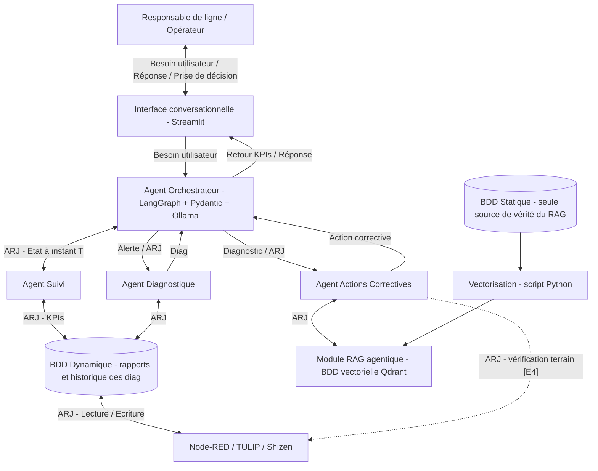
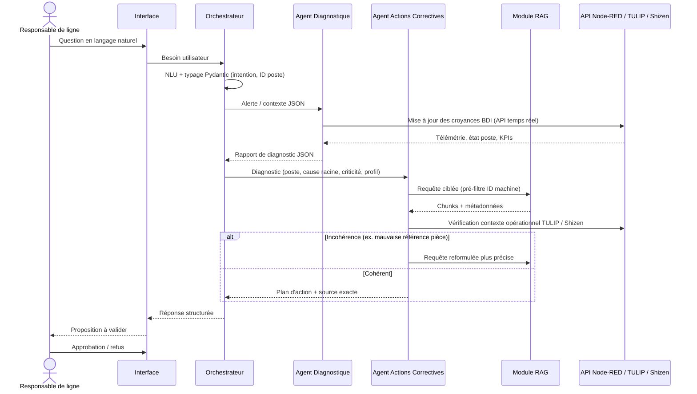
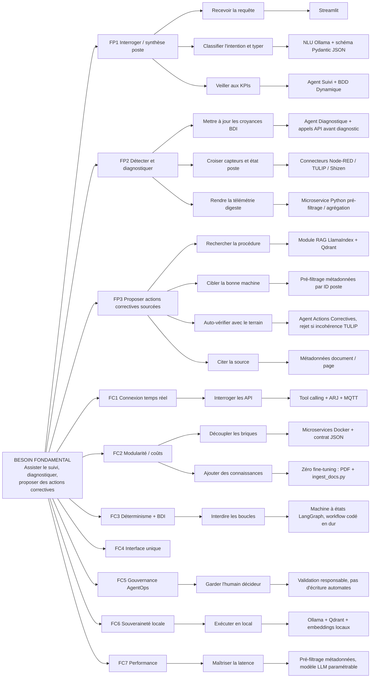
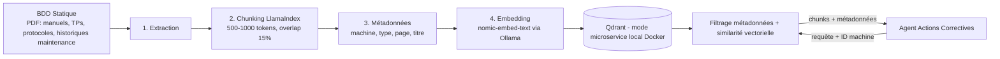

# PJE 17 — Plateforme IA Agentique d'assistance au pilotage de l'usine-école 4.0
## Compte rendu de verrouillage : architecture & analyse fonctionnelle

> **Convention :** `ARJ` = API REST JSON (légende du schéma).

---

# 1. Contexte

## 1.1 Objectifs du projet

| # | Objectif (source : cadrage + sujet PJE09 n°17) |
|---|---|
| O1 | Assister les responsables de ligne dans le suivi quotidien de la production et la prise de décision |
| O2 | Détecter automatiquement les anomalies et établir un diagnostic industriel factuel |
| O3 | Synthétiser l'état d'un poste et proposer des actions correctives concrètes, sourcées, conformes aux standards Lean |
| O4 | Fournir une plateforme modulaire (ajout / modification / suppression d'agents sans refonte) |
| O5 | *À terme* : étendre l'assistance aux opérateurs via de nouvelles modalités (ex. commande vocale) |

## 1.2 Enjeux métiers

- **Goulot d'étranglement humain :** forte production de données (Node-RED, TULIP, Shizen) mais décision retardée par la dispersion des écrans, le recoupement manuel et la recherche manuelle dans les classeurs de procédures.
- **Passage du reporting à l'action :** réponse exploitable en une seule requête conversationnelle (synthèse poste + diagnostic + action corrective prête à valider).
- **Fiabilité :** risque *Critique* d'hallucination procédurale ; risque *Élevé* de décisions erronées (données silotées/incomplètes) ; risques *Moyens* de boucles inter-agents et de rejet utilisateur (boîte noire).
- **Cadre Industrie 5.0 / Opérateur 4.0 :** l'IA augmente l'humain, ne le remplace pas (human-in-the-loop).
- **Vitrine technologique :** terrain d'expérimentation pérenne, réutilisable par les futures promotions.

## 1.3 Périmètre

| Inclus | Exclu |
|---|---|
| Interface conversationnelle unique (point d'entrée) | Ré-entraînement / fine-tuning du LLM |
| Orchestrateur centralisé déterministe | Commande ou écriture physique sur les automates |
| Agents : Suivi, Diagnostique, Actions Correctives | Décision autonome de l'IA (validation humaine obligatoire) |
| Connecteurs API temps réel : Node-RED, TULIP, Shizen | LLM cloud propriétaire (exfiltration de données) |
| Module RAG agentique + pipeline d'ingestion documentaire | Orchestration décentralisée / fédérée |
| Gouvernance AgentOps : traçabilité des sources, workflow d'approbation | Commande vocale opérateur (horizon « à terme », O5) |
| Exécution 100 % locale (Ollama, Qdrant, Docker) | Remplacement de TULIP / Node-RED / Shizen |

## 1.4 Acteurs, utilisateurs cibles, contraintes initiales

**Acteurs**

| Acteur | Rôle vis-à-vis du système | Besoin clé | Risque à lever |
|---|---|---|---|
| Responsable de ligne (A.1) | Utilisateur principal, décideur final | Interface unique, état des lieux + diagnostic auto, procédure officielle | Boîte noire ; exige transparence des sources |
| Opérateur de ligne (A.2) | Utilisateur au poste (maintenance 1er niveau) | Guide pas à pas court et instantané, autonomie | Blocage dans l'attente du responsable |
| Direction usine-école / encadrants (A.3) | Garants méthodologiques et techniques | Modularité, déterminisme, fiabilité scientifique | Architecture non évolutive, hallucinations |
| Futurs étudiants / développeurs | Maintiennent et étendent la plateforme | Ajouter un agent / un PDF sans tout refaire | Dette technique, couplage fort |
| Administrateur d'ingestion | Exécute `ingest_docs.py` | Mise à jour de la base documentaire | — |
| Systèmes externes | Node-RED, TULIP, Shizen, documentation interne | Exposer leurs données via API | — |
| Équipe Infrastructure SI | Fournisseur des API existantes | — | Faits : TULIP = Basic Auth (clé API en identifiant, secret en mot de passe), jetons à scopes par ressource (Tables, Operators, Machines, Apps) *(Tulip Support)* ; Shizen = API proposée par l'éditeur, authentification non publique → documentation éditeur / onboarding *(fiches éditeur)* ; Node-RED = flux JSON/MQTT, identifiants et ACL du broker à obtenir *(Dossier §2.2)*. Retenu : un compte de service en lecture seule par source, secrets en variables d'environnement Docker. |

**Contraintes initiales**

- **Souveraineté / confidentialité :** traitement local, zéro fuite vers le cloud.
- **Zero-cost :** infrastructures locales + open source, aucun abonnement/API payante.
- **Déterminisme :** pas de boucles infinies inter-agents ; workflow codé en dur.
- **Humain dans la boucle :** approbation pour toute action impactant la ligne.
- **Traçabilité :** toute action corrective cite l'extrait documentaire source.
- **Matériel :** ressources RAM/VRAM locales limitantes ; modèle LLM paramétrable selon la machine ; tool calling local à stabiliser.
- **Latence :** « acceptable » malgré le raisonnement multi-étapes du RAG agentique Cibles : synthèse FP1 ≤ 10 s ; enchaînement FP2→FP3 ≤ 30 s avec progression affichée par étape ; 10 s = limite d'attention de l'utilisateur, au-delà un retour d'avancement est nécessaire *(NN/g)* ; à mesurer sur le matériel local *(Dossier §1.4)*.

## 1.5 Registre des écarts entre sources (à arbitrer)

| ID | Écart | Hypothèse de travail retenue dans ce document |
|---|---|---|
| E1 | **Accès au RAG :** schéma = lien direct Agent Actions Correctives ↔ RAG ; fiche agent = « interroge **via l'Orchestrateur** le Module RAG » ; schéma de première réflexion = RAG relié à l'Orchestrateur | Requête initiée par l'Agent Actions Correctives, **médiée par l'Orchestrateur** (cohérent avec le contrôle centralisé). Retenu : AAC → Orchestrateur → RAG (requête médiée, point de contrôle unique) *(Dossier §4.2, §4.6)* ; schéma §2.1 à aligner ; validation par l'encadrant = action humaine restante |
| E2 | **Base vectorielle :** Qdrant (FAST, guide RAG, synthèse) vs ChromaDB (pipeline d'ingestion, synthèse « lit ChromaDB ») | **Qdrant** retenu (majoritaire, microservice Docker). ChromaDB = alternative prototype |
| E3 | **« Lecture / Écriture »** schéma entre BDD Dynamique et Node-RED/TULIP/Shizen vs « l'IA n'écrit pas sur les automates » (FAST, fiche AAC) | Écriture = alimentation de la BDD Dynamique uniquement ; **aucune commande vers les automates**. Aucune écriture vers TULIP / Shizen en v1 : lecture seule, scopes de jeton limités au besoin *(Tulip Support ; Dossier §1.3, FC5)* ; création de ticket = évolution post-v1 soumise à approbation humaine |
| E4 | **Accès temps réel de l'Agent Actions Correctives :** fiche = connecteurs API directs vers TULIP/Shizen ; schéma = aucun lien AAC ↔ sources terrain | Accès via la **couche connecteurs** (microservice Python), non figuré au schéma. L'AAC lit TULIP / Shizen via la couche connecteurs (§4.7), en lecture seule ; conserver au schéma le lien pointillé AAC → sources [E4] *(Dossier §2.1, §4.5)* |
| E5 | **Rôle de la BDD Dynamique :** schéma = « stocke rapports et historique des diag » + liaison lecture/écriture vers les sources ; FAST = « API terrain (BDD Dynamique) » | BDD Dynamique = couche de persistance **applicative** (rapports, historique, KPIs servis à l'Agent Suivi) ; réplique/cache des sources non confirmée. BDD Dynamique = persistance applicative (rapports, historique, KPIs en instantanés horodatés) ; pas de réplique des sources : les croyances BDI sont rafraîchies par appel API avant tout diagnostic *(Dossier §4.4, FC3)* |
| E6 | **Opérateurs :** utilisateurs ciblés par les fiches agents et le schéma (« Opérateur / Manager ») vs « à terme » dans les objectifs | Responsable de ligne = utilisateur v1 ; opérateur = utilisateur cible, modalité vocale hors périmètre v1 |
| E7 | **Agent Suivi :** présent au schéma et au FAST (rattaché à FP1), mais aucune fiche dédiée ni FP/FC propre | Rattaché à **FP1 (+ amont FP2)** ; spécification détaillée Rattaché à FP1 (+ amont FP2) ; fiche complète en §4.3 *(Dossier §4.3)* |
| E8 | **Origine de l'« Alerte »** (Orchestrateur → Agent Diagnostique) non spécifiée | Les deux : (a) seuil franchi détecté par l'Agent Suivi, (b) requête utilisateur classée DIAGNOSTIC ; dans les deux cas l'Orchestrateur émet l'Alerte JSON, jamais Suivi → Diagnostique en direct *(Dossier §4.2, §4.3, FC3)* |
| E9 | **Technologie SQL/NoSQL** de la BDD Dynamique et de la BDD Statique non spécifiée | BDD Dynamique : PostgreSQL (JSONB) ; BDD Statique : fichiers + manifeste de hash *(détail §5.2–5.3 ; PostgreSQL docs)* (§5) |

---

# 2. Analyse Fonctionnelle

## 2.1 Vue d'ensemble et finalité

**Besoin fondamental :** *Assister le suivi quotidien de la production, diagnostiquer automatiquement les anomalies et proposer des actions correctives afin d'accélérer la prise de décision* — au service des acteurs de l'usine-école, en agissant sur les flux de données industrielles et les bases de données, via une plateforme IA agentique modulaire.

**Principe architectural :** architecture **hybride (microservices)** isolant la connectivité (API, sessions) de la logique métier (raisonnement IA) + **orchestration centralisée** (un seul « cerveau » déterministe) + **modèle cognitif BDI** (croyances mises à jour par API avant toute intention) + **RAG agentique** (connaissance déportée hors du LLM).

## 2.2 Interactions système ↔ environnement extérieur

| Élément extérieur | Sens | Nature de l'interaction | Fonction liée |
|---|---|---|---|
| Responsable de ligne / Opérateur | ↔ | Requêtes langage naturel ; réponses, KPIs, plans d'action ; **validation / refus** | FP1, FC4, FC5 |
| Node-RED | → | Flux capteurs/machines (JSON/MQTT, séries temporelles, états binaires) | FP2, FC1 |
| TULIP | → | Statut poste, étape de gamme, temps de cycle vs takt time, signalements opérateur (REST/JSON) | FP1, FP2, FP3, FC1 |
| Shizen / Lean | → | KPIs temps réel, anomalies ouvertes, tickets, standards d'amélioration continue | FP1, FP2, FP3, FC1 |
| Documentation interne (manuels, TPs, protocoles, historiques de maintenance) | → | Ingestion hors-ligne (PDF) → vectorisation | FP3, FC2 |
| Infrastructure SI / API existantes | ↔ | Exposition des API consommées par les connecteurs | FC1 |
| Équipe encadrante / développeurs | ↔ | Ajout/retrait d'agents, ajout de PDF, choix du modèle LLM | FC2 |
| Automates / équipements physiques | ✗ | **Aucune écriture / commande** par l'IA | FC5 |

## 2.3 Flux principaux

**Entrées**

| Flux | Origine | Format |
|---|---|---|
| Requête utilisateur | Interface | Texte libre |
| Intention structurée + ID poste | NLU Orchestrateur | JSON typé Pydantic |
| Télémétrie machine | Node-RED | JSON/MQTT, séries temporelles (pré-agrégées par microservice Python) |
| Opérations 1re ligne | TULIP | JSON (REST) + texte court |
| KPIs / anomalies | Shizen | JSON + texte libre (tickets) |
| Documents techniques | BDD Statique | PDF → chunks + métadonnées |

**Sorties**

| Flux | Destinataire | Format |
|---|---|---|
| Synthèse état poste / KPIs | Interface → utilisateur | Synthèse structurée |
| Rapport de diagnostic | Orchestrateur, BDD Dynamique | JSON structuré |
| Plan d'action corrective **avec source citée** | Orchestrateur → utilisateur | Texte ordonné + citation (document, page) |
| Décision (approbation/refus) | Interface → Orchestrateur | JSON Pydantic {reco_id, poste_id, decision ∈ APPROUVE / REFUSE / MODIFIE, motif, user_id, horodatage} ; journalisé en table append-only `decision_log` (BDD Dynamique) ; reprise du graphe par `interrupt()` + `Command(resume=…)`, checkpointer obligatoire *(LangGraph docs ; Dossier FC5)* |

**Flux nominal (diagnostic → action corrective)**

---

# 3. Analyse Fonctionnelle Détaillée

## 3.1 Fonctions Principales (FP)

| ID | Mission |
|---|---|
| **FP1** | Permettre au responsable de ligne d'interroger la plateforme en langage naturel (point d'entrée unique) pour obtenir une synthèse de l'état d'un poste |
| **FP2** | Détecter automatiquement les anomalies et établir un diagnostic industriel factuel (cause racine) en croisant les données Node-RED, TULIP, Shizen |
| **FP3** | Proposer des actions correctives concrètes, sourcées, en associant le diagnostic aux procédures et à la documentation internes |

## 3.2 Fonctions Contraintes (FC)

**FC1–FC5 : liste officielle du dossier de cadrage. FC6–FC7 : exigences explicites des sources, non numérotées à l'origine, ajoutées pour compléter la couverture souveraineté / performance.**

| ID | Exigence | Catégorie |
|---|---|---|
| **FC1** | Se connecter et interroger en temps réel les applications et bases existantes via API (Node-RED, TULIP, Shizen) | Technique |
| **FC2** | Architecture modulaire et évolutive (ajout/retrait d'agents ; ajout de documents sans ré-entraînement ; coûts technologiques maîtrisés) | Technique |
| **FC3** | Système déterministe, ancré sur le modèle BDI (croyances à jour avant intention) | Fiabilité |
| **FC4** | Interface conversationnelle intuitive servant de point d'entrée unique | Ergonomie |
| **FC5** | Gouvernance et traçabilité (AgentOps), humain dans la boucle, citation obligatoire des sources, aucune écriture sur automates | Sécurité / gouvernance |
| **FC6** *(complémentaire)* | Souveraineté et confidentialité : exécution locale (LLM, embeddings, base vectorielle), zéro donnée vers le cloud ; zero-cost (open source) | Réglementaire / sécurité / budget |
| **FC7** *(complémentaire)* | Performance : latence de réponse acceptable malgré le raisonnement multi-étapes ; compatibilité avec les ressources matérielles locales | Performance |

## 3.3 Diagramme FAST

## 3.4 Cahier des Charges — synthèse verrouillée

> **Priorités :** déduites des niveaux de risque de la matrice de gouvernance (Critique / Élevé / Moyen), non fixées explicitement dans les sources. Priorités conservées telles que dérivées de la matrice de risques (Critique : FP3, FC3, FC5 ; Haute : FP1, FP2, FC1, FC2, FC6 ; Moyenne : FC4, FC7) *(Dossier §1.2 et tableau ci-dessous)* ; validation par l'encadrant = action humaine restante
> **KPI :** les sources fixent des cibles qualitatives (« toutes », « systématiquement »), interprétées en 100 %. Seuils numériques de latence absents.

| ID | Description | Critères d'acceptation / KPI | Priorité |
|---|---|---|---|
| **FP1** | Requête en langage naturel → synthèse d'un poste | L'Orchestrateur interroge les connecteurs API et restitue une synthèse structurée des KPIs temps réel du poste en **une seule requête** ; intention + ID poste extraits en JSON Pydantic valide | Haute |
| **FP2** | Détection d'anomalies et diagnostic de cause racine | Agent Diagnostique identifie la cause racine en croisant alerte capteur (Node-RED) et statut poste (TULIP) sur les **scénarios de test** ; rapport JSON systématiquement valide | Haute |
| **FP3** | Actions correctives sourcées | **100 %** des actions proposées citent un extrait réel de la documentation (document + page) issu du RAG ; plan conforme aux standards Lean ; extrait rejeté si incohérent avec TULIP | **Critique** |
| **FC1** | Connexion temps réel aux API | Connecteurs opérationnels Node-RED (MQTT), TULIP, Shizen ; échanges ARJ ; données brutes pré-filtrées avant LLM | Haute |
| **FC2** | Modularité / évolutivité / coûts | Ajout d'un agent sans réécriture de l'existant (contrat JSON + orchestrateur) ; ajout d'un PDF = dépôt + relance ingestion, **sans ré-entraînement** | Haute |
| **FC3** | Déterminisme + BDI | **100 %** des requêtes des scénarios de test aboutissent à une réponse structurée ; **taux d'ancrage BDI = 100 %** (appel API systématique avant diagnostic, aucun état de capteur inventé) ; 0 boucle infinie | **Critique** |
| **FC4** | Interface unique | Un seul point d'entrée donnant accès à Suivi, Diagnostic, Actions Correctives | Moyenne |
| **FC5** | Gouvernance / AgentOps / humain dans la boucle | Source documentaire affichée pour chaque recommandation ; workflow d'approbation avant toute action impactant la ligne ; aucune écriture automate. Contenu : thread_id, horodatage, intention + ID poste, rapport de diagnostic, chunks RAG cités (document, page), plan proposé, décision humaine, modèle LLM utilisé, latence par étape ; stockage : tables append-only `agentops_log` / `decision_log` dans PostgreSQL + checkpoints LangGraph *(LangGraph docs ; Dossier FC5)* | **Critique** |
| **FC6** | Souveraineté locale, zero-cost | Aucun appel à un service cloud payant ou externe ; LLM, embeddings, vector DB hébergés localement | Haute |
| **FC7** | Performance | Temps de réponse « acceptable » malgré le multi-étapes. FP1 ≤ 10 s ; FP2→FP3 ≤ 30 s avec progression par étape *(NN/g ; cf. §1.4)* ; à valider par mesure sur le matériel cible | Moyenne |

---

# 4. Choix d'Architecture Détaillé par Agent

## 4.0 Vue d'ensemble et pile transverse

**Principe de répartition :**

| Composant | Nature | Responsabilité | FP/FC |
|---|---|---|---|
| Interface conversationnelle | Front-end | Point d'entrée unique, approbation humaine | FP1, FC4, FC5 |
| Agent Orchestrateur | Agent (routeur) | NLU, typage, workflow, consolidation | FP1–FP3, FC2, FC3, FC5 |
| Agent Suivi | Agent | Veille des KPIs | FP1, FP2 (amont), FC1 |
| Agent Diagnostique | Agent | Croyances BDI + cause racine | FP2, FC1, FC3 |
| Agent Actions Correctives | Agent | Procédure sourcée + auto-vérification | FP3, FC3, FC5 |
| Module RAG | Composant | Recherche vectorielle filtrée | FP3, FC2, FC5, FC6 |
| Couche connecteurs | Microservice Python | Accès API, pré-filtrage/agrégation | FC1, FC7 |

**Pile LLM / inférence (transverse à tous les agents)**

| Brique | Options évaluées | Choix | Justification |
|---|---|---|---|
| Moteur d'inférence | vLLM, llama.cpp, Ollama | **Ollama** | Déploiement simple, API REST compatible OpenAI, gestion automatique des modèles, charge matérielle optimisée CPU/GPU → FC6, FC7. Rejets : vLLM (GPU dédié CUDA, lourdeur injustifiée pour un prototype) ; llama.cpp (plomberie de code conséquente, mono-flux). Limite assumée : mono-utilisateur / prototypage |
| Type de modèle | Cloud propriétaire (GPT-4o-mini, Claude 3.5 Sonnet), open weights locaux, modèles spécialisés code (Qwen-Coder, CodeLlama) | **Open weights locaux** (Llama 3.2 3B / Llama 3 8B cités) | Cloud rejeté : coût + exfiltration de données (viole FC6). Modèles code : bons en JSON/syntaxe API mais moins bons en synthèse pédagogique. Limite : tool calling local à stabiliser |
| Sélection du modèle | — | **Modèle configurable à l'exécution** | Adaptation à la machine ; modèle léger (prototypage) vs robuste (validation) → FC2, FC7. Un modèle par agent, déclaré dans la configuration (§5.3) ; liste finale = Llama 3.2 3B (prototypage) et Llama 3 8B (validation) *(Dossier §4.0)* ; sorties contraintes par schéma JSON pour réduire l'écart entre modèles *(Ollama docs)* |

---

## 4.1 Interface conversationnelle (composant front-end)

- **Nom et rôle :** Interface conversationnelle (Streamlit) — seul point de contact humain ; affiche synthèses, KPIs, plans d'action et sources ; porte l'approbation/refus.
- **Besoin couvert :** **FP1**, **FC4**, **FC5** (validation humaine, affichage de la source).
- **Justification architecturale :** Streamlit (100 % Python) se connecte nativement à la logique backend sans API front/back dédiée. Écarté : React/Vue.js (jugés lourds). Chainlit cité comme alternative Python. Limite : Streamlit n'est pas pensé pour la forte concurrence (cohérent avec le périmètre prototype).
- **Entrées / Sorties & Outils :**
  - *Entrées :* texte libre ; action d'approbation/refus.
  - *Sorties :* prompt vers l'Orchestrateur ; réponse structurée + sources ; KPIs (« Retour KPIs »).
  - *Outils :* script `app.py`. Approbation : boutons Approuver / Refuser / Modifier sous chaque plan → objet décision (§2.3) ; historisation : table `decision_log` ; authentification : OIDC natif Streamlit (`st.login` / `st.user`, version ≥ 1.42, fournisseur OIDC requis) *(Streamlit docs)* ; sans fournisseur OIDC sur site : sélection de profil locale, sans valeur d'authentification forte (prototype)

## 4.2 Agent Orchestrateur

- **Nom et rôle :** Agent Orchestrateur centralisé — **routeur logiciel, non résolveur**. Cycle : (1) écouter, (2) classifier l'intention (NLU via LLM), (3) typer/formater en JSON, (4) exécuter le workflow codé en dur vers les sous-agents, (5) consolider la réponse. Seul agent lié à l'interface.
- **Besoin fonctionnel couvert :** **FP1** (compréhension et point d'entrée), délégation de **FP2** et **FP3** ; **FC2** (contrat JSON), **FC3** (déterminisme), **FC4**, **FC5**, **FC6**, **FC7**.
- **Justification architecturale :**

| Décision | Justification | Alternatives écartées |
|---|---|---|
| **Orchestration centralisée** | Point de contrôle unique → cohérence, prévisibilité, aucune boucle de communication inter-agents (FC3) ; masque la complexité à l'utilisateur (FP1) | Décentralisée (anarchie décisionnelle, décisions lentes, coordination) ; fédérée (pertinente pour entités indépendantes, hors besoin) ; hiérarchique (complexité de gestion non justifiée) |
| **LangGraph (machine à états)** | Chemins figés : *Diagnostic* → toujours *Actions Correctives* ; sens de circulation imposé → boucle impossible (FC3/FC5) | Frameworks à agents « libres » (risque de boucles) |
| **Pydantic + Ollama (NLU)** | Schéma strict (Enum d'intentions), prompt système restreint, sortie JSON valide obligatoire ; **le JSON est le contrat d'interface** : tout nouvel agent sait quoi lire (FC2) | Sortie texte libre (hallucination du routage) |
| **Architecture hybride microservices** | Isole connectivité / raisonnement, réduit la complexité cyclomatique, ajout d'agents sans refonte (FC2) | Monolithe |

  *Limite assumée :* goulot d'étranglement au niveau du leader (inhérent à l'approche verticale), acceptable pour un nombre restreint d'agents.
- **Entrées / Sorties & Outils :**
  - *Entrées :* prompt texte ; rapports JSON des agents ; décision humaine.
  - *Sorties :* objet JSON typé (intention, ID poste) ; appels ARJ aux agents ; réponse consolidée vers l'interface ; « Alerte » vers l'Agent Diagnostique ; « Diagnostic » vers l'Agent Actions Correctives.
  - *Outils :* LangGraph, Pydantic, Ollama.
  - *Points ouverts :* Enum = SUIVI, DIAGNOSTIC, HORS_PERIMETRE (l'action corrective n'est pas une intention directe : toujours enchaînée après DIAGNOSTIC) *(Dossier §3.3)* ; hors périmètre : réponse standard de redirection, aucun agent appelé, sortie typée par schéma JSON *(Ollama docs)* ; persistance : checkpointer LangGraph (PostgreSQL ; SQLite en prototype mono-machine), un `thread_id` par session *(LangGraph docs)* ; déclencheur de l'Alerte : cf. E8

## 4.3 Agent Suivi

- **Nom et rôle :** Agent Suivi — brique **amont** de veille des KPIs (Shizen/TULIP) avant l'alerte ; fournit l'« État à l'instant T » et le « Retour KPIs » à l'Orchestrateur, en s'appuyant sur les KPIs de la BDD Dynamique (schéma).
- **Besoin fonctionnel couvert :** **FP1** (cas d'usage « bilan d'état d'un poste », synthèse KPIs temps réel), **FP2** (amont de la détection), **FC1**, **FC2** (exemple d'agent ajouté de façon modulaire). `[E7]`
- **Justification architecturale :** agent distinct du Diagnostique pour garder un périmètre strict (limite la complexité cyclomatique) et illustrer l'extensibilité modulaire (« ajouter facilement de nouveaux agents, ex. Agent de suivi »). Lecture seule, sans rédaction de diagnostic ni consultation documentaire *(périmètre déduit de la répartition FAST/schéma, non explicité dans une fiche)*. Alternative écartée : faire porter la veille par l'Orchestrateur (violerait son rôle de simple routeur).
- **Entrées / Sorties & Outils :**
  - *Entrées :* requête ARJ de l'Orchestrateur ; KPIs via BDD Dynamique / API Shizen-TULIP.
  - *Sorties :* état à l'instant T et KPIs au format ARJ.
  - *Outils :* connecteurs API.
  - Mode : polling périodique par la couche connecteurs (Node-RED en abonnement MQTT agrégé) + lecture à la demande ; fréquence 60 s par défaut, configurable ; KPIs : Shizen (KPIs temps réel, anomalies ouvertes) et TULIP (statut poste, temps de cycle vs takt time) *(Dossier §2.2)* ; seuils d'alerte par poste dans la configuration, jamais décidés par le LLM (FC3) ; sortie JSON {poste_id, horodatage, kpis, ecarts, alerte}

## 4.4 Agent Diagnostique

- **Nom et rôle :** Agent Diagnostique — met à jour ses **croyances BDI** par appels API temps réel, puis croise flux capteurs et état du poste pour établir la cause racine. Jamais appelé directement par un humain (déclenché par l'Orchestrateur).
- **Besoin fonctionnel couvert :** **FP2** (principal), **FC1** (accès temps réel), **FC3** (ancrage BDI), **FC7** (résumés JSON digestes).
- **Justification architecturale :**
  - **BDI** : l'usine est un environnement dynamique continu ; l'agent ne réagit pas aveuglément à une alerte, il vérifie d'abord que sa croyance justifie l'intention → lève le risque *Élevé* de décisions erronées.
  - **Périmètre strict** : ne cherche pas les manuels, ne rédige pas le plan d'action (rôle FP3). Évite chevauchements et boucles.
  - **Pré-traitement par microservice Python** : la télémétrie brute (séries temporelles) est pré-filtrée/agrégée en résumé JSON avant le LLM (un LLM ne digère pas des séries brutes ; FC7).
  - *Écarté :* diagnostic par un LLM seul sans appel API (hallucination d'état de capteur).
- **Entrées / Sorties & Outils :**

| Entrée | Source | Contenu |
|---|---|---|
| Intention + contexte | Orchestrateur | JSON (intention, ID poste) |
| Flux machines | Node-RED | JSON/MQTT, séries temporelles : valeurs physiques, états binaires (présence pièce 0/1, voyant rouge, arrêt d'urgence) |
| Opérations 1re ligne | TULIP | Statut poste, étape de gamme, temps de cycle vs takt time, signalements opérateur |
| Performance / anomalies | Shizen | KPIs temps réel, anomalies ouvertes, dérives |

  - *Sorties :* rapport de diagnostic JSON structuré → Orchestrateur ; écriture du rapport/historique dans la BDD Dynamique (schéma, double flèche ARJ).
  - *Outils :* tool calling sur connecteurs API (Node-RED, TULIP, Shizen).
  - *KPI :* taux d'ancrage BDI, exactitude des causes racines (corrélation alerte Node-RED × statut TULIP), validité du format de sortie.
  - Rapport = {poste_id, horodatage, cause_racine, niveau_criticite, profil_utilisateur, preuves[{source, valeur, horodatage}]} validé par Pydantic *(champs minimaux : Dossier §4.5 ; contrainte de schéma : Ollama docs)* ; `preuves` ajouté pour tracer l'ancrage BDI ; accès : API directe via les connecteurs avant chaque diagnostic, BDD Dynamique réservée à la persistance *(Dossier FC3, E5)*

## 4.5 Agent Actions Correctives

- **Nom et rôle :** Agent Actions Correctives — agit **en aval** du diagnostic ; transforme la cause racine en plan d'action corrective sourcé, conforme aux standards Lean ; porte la dimension **agentique** du RAG (décomposition, croisement de sources, auto-vérification, reformulation).
- **Besoin fonctionnel couvert :** **FP3** (principal), **FC3** (ancrage terrain, déterminisme du flux), **FC5** (citation obligatoire, assistant de recommandation soumis à approbation), **FC2** (connaissance externalisée).
- **Justification architecturale :**
  - **RAG** plutôt que fine-tuning : élimine le risque *Critique* d'hallucination procédurale (injection du contexte exact), évite un ré-entraînement coûteux à chaque nouveau manuel, permet l'ajout de PDF sans retouche du modèle (FC2) ; une API classique ne comprend pas le sens d'un PDF et un manuel complet saturerait la fenêtre de contexte.
  - **RAG agentique** plutôt que RAG traditionnel : un RAG réactif ferait aveuglément confiance au document extrait, sans auto-vérification. Ici, si TULIP indique une référence de pièce / étape différente, l'extrait est **rejeté** et une requête plus précise est relancée. Coût accepté : latence plus élevée (multi-étapes) → compensée par le pré-filtrage métadonnées.
  - **Boucle d'auto-vérification bornée :** Maximum 2 reformulations (3 requêtes RAG au total) ; repli : renvoyer le diagnostic seul + « aucune procédure validée trouvée », escalade au responsable, aucun plan inventé *(Dossier FP3 : 100 % sourcé)* ; compteur dans l'état du graphe + `recursion_limit` LangGraph en garde-fou (25 par défaut) *(LangGraph docs)*.
- **Entrées / Sorties & Outils :**

| Entrée | Source | Contenu |
|---|---|---|
| Rapport de diagnostic validé | Orchestrateur | JSON : ID poste, cause racine, criticité, profil utilisateur (adapte le niveau de langage) |
| Extraits documentaires | Module RAG | Chunks + métadonnées (titre document, machine, type, page) |
| Contexte opérationnel / Lean | TULIP, Shizen (API) | Étape de gamme, instructions opérateur en cours, historique tickets, standards d'amélioration continue |

  - *Sorties :* plan d'action séquencé, concret, avec **citation exacte** (document, page) → Orchestrateur → interface → validation humaine.
  - *Outils :* requête RAG avec pré-filtre ID machine ; connecteurs API TULIP/Shizen (via couche connecteurs, [E4]) ; LLM (Ollama).
  - *Hors périmètre :* analyse de télémétrie brute (rôle de l'Agent Diagnostique), toute écriture/commande sur automates.

## 4.6 Module RAG (composant, non décisionnel)

- **Nom et rôle :** Module RAG — service de récupération : recherche de similarité vectorielle + filtrage par métadonnées sur la base vectorielle ; renvoie chunks et métadonnées. Alimenté hors-ligne par un script d'ingestion.
- **Besoin couvert :** **FP3**, **FC2**, **FC5** (traçabilité), **FC6**, **FC7**. Détail §5.1.
- **Justification :** composant isolé (microservice Docker) pour respecter la séparation connectivité/raisonnement ; l'intelligence de vérification est portée par l'Agent Actions Correctives, le module reste déterministe en récupération. Accès : cf. [E1].
- **E/S & outils :** entrée = requête + ID machine ; sortie = top chunks + métadonnées ; outils : LlamaIndex, Qdrant, embeddings Ollama.

## 4.7 Couche connecteurs (microservice Python)

- **Nom et rôle :** connecteurs API vers Node-RED (MQTT), TULIP, Shizen ; pré-filtrage et agrégation des séries temporelles.
- **Besoin couvert :** **FC1**, **FC7**, **FC2** (isolation de la connectivité).
- **Justification :** isole la logique de connectivité de la logique IA (architecture hybride) ; transmet au LLM des résumés JSON plutôt que des flux bruts.
- **E/S & outils :** entrées = API REST/MQTT ; sortie = JSON normalisé ; usage via tool calling. Node-RED : broker MQTT, un topic par machine *(Dossier §2.2)* ; TULIP : REST `https://{instance}.tulip.co/api/v3/w/{workspace}/…`, Basic Auth clé / secret *(Tulip Support)* ; Shizen : API éditeur, endpoints et auth dans la doc éditeur *(fiches éditeur)* ; fréquences : cf. §4.3 (60 s par défaut) ; mapping : table de configuration `poste_id ↔ machine_id ↔ topic MQTT ↔ station TULIP`, `machine_id` = métadonnée `machine` du RAG *(Dossier §5.1)*

---

# 5. Choix d'Architecture et Solutions pour les Bases de Données

## 5.1 Architecture RAG (base vectorielle)

**Pipeline d'ingestion (hors-ligne, exécuté par un administrateur via `ingest_docs.py`)**

| Paramètre | Décision | Justification (besoin) | Statut |
|---|---|---|---|
| **Découpage** | Segments de 500–1000 tokens, chevauchement 15 % (LlamaIndex) | Ne jamais couper une procédure en plein milieu ; éviter la saturation du contexte → FP3, FC7 | Verrouillé (valeurs « exemple » dans la source) |
| **Métadonnées obligatoires** | `{machine, type, page}` + titre du document, par chunk | Pré-filtrage strict par machine ; citation de la page exacte → FC5 (AgentOps), FP3 | Verrouillé |
| **Embeddings** | `nomic-embed-text` via Ollama (cité « ex. ») | Modèle local, vecteurs sémantiques → FC6 | Confirmé : `nomic-embed-text`, dimension 768, contexte 8192 tokens *(Ollama library ; wrappers Ollama)* → `size=768` à la création de la collection Qdrant |
| **Framework RAG** | **LlamaIndex** (ou hybridation Python custom) | Excellente gestion des PDF complexes et du lien chunk ↔ document source → FC5 | Verrouillé |
| **Base vectorielle** | **Qdrant** local conteneurisé (Docker) | Confidentialité (FC6), isolation microservice (FC2) | Verrouillé [E2] |
| **Stratégie de retrieval** | Similarité vectorielle + **pré-filtrage par ID machine** (ID fourni par l'Orchestrateur) | Évite de retourner une procédure similaire d'une autre machine ; réduit l'espace de recherche → latence (FC7) et erreurs de contexte (FC3) | Verrouillé |
| **Recherche hybride lexicale + sémantique (BM25 ou équivalent)** | Non mentionnée dans les sources | — | Non retenue en v1 : similarité + pré-filtre `machine` suffisent *(Dossier §5.1)* ; option si les références exactes (codes pièce) sont mal retrouvées : Qdrant gère nativement vecteurs creux + denses avec filtres *(Qdrant docs)* |
| **Paramètres d'interrogation** | — | — | Métrique Cosine (usuelle pour les embeddings texte) *(Qdrant docs)* ; top-k = 5 (valeur de départ) ; seuil de score à calibrer sur le jeu de scénarios de test (Qdrant permet de filtrer par score) *(Qdrant docs)* ; rejet d'un chunk si score < seuil ou incohérent avec le contexte TULIP (référence pièce / étape) → reformulation bornée (§4.5) |
| **Mise à jour** | Dépôt du PDF dans le dossier + relance du script ; l'agent lit seulement la base | Zéro ré-entraînement → FC2 | Verrouillé. Incrémentale : `IngestionPipeline` LlamaIndex + docstore (hash par document : modifié → ré-indexé, inchangé → ignoré), stratégie `upserts_and_delete` pour retirer les PDF supprimés *(LlamaIndex docs)* |

**Séparation des rôles :** le script d'ingestion (administrateur) est découplé de l'Agent Actions Correctives, qui est **en lecture seule** sur la base vectorielle.

## 5.2 Bases de données dynamiques

**Périmètre (schéma) : « BDD Dynamique — stocke les rapports et l'historique des diagnostics »**, lue par l'Agent Suivi (KPIs) et l'Agent Diagnostique (lecture/écriture), reliée en lecture/écriture à Node-RED / TULIP / Shizen.

| Donnée | Producteur → Consommateur | Besoin | Statut |
|---|---|---|---|
| Rapports de diagnostic (JSON) | Agent Diagnostique → BDD → Orchestrateur / AAC | FP2, FP3 | Cité (schéma) |
| Historique des diagnostics | Agent Diagnostique → BDD | FP2, FC5 (traçabilité) | Cité (schéma) |
| KPIs temps réel / état à l'instant T | Sources → BDD → Agent Suivi | FP1, FC1 | Cité (schéma) |
| Télémétrie pré-agrégée | Node-RED → couche connecteurs | FP2, FC7 | Transitoire (résumé JSON agrégé en mémoire par les connecteurs) ; seul le résumé cité dans un rapport est persisté avec lui *(Dossier §4.4, FC7)* |
| État du workflow / mémoire conversationnelle | Orchestrateur (LangGraph) | FC3, FP1 | Checkpoints LangGraph dans PostgreSQL (SQLite en prototype), un `thread_id` par session *(LangGraph docs)* |
| Logs AgentOps / décisions d'approbation | Interface, Orchestrateur | FC5 | Tables append-only `agentops_log` et `decision_log` ; contenu défini en §3.4 (FC5) |

- **Technologie (SQL / NoSQL) :** **PostgreSQL** : rapports en `JSONB` + index GIN (requêtes de containment sur l'historique), conteneur Docker local, open source ; alternative prototype : SQLite *(PostgreSQL docs ; LangGraph docs pour les checkpointers)*. Critères de choix déductibles des sources : stockage de documents JSON (rapports), historique requêtable, accès ARJ, exécution locale et conteneurisable (FC2, FC6), zero-cost (open source).
- **Règle de gouvernance :** les écritures concernent la BDD Dynamique, jamais les automates (FC5) `[E3]`.

## 5.3 Bases de données statiques / référentiels

| Référentiel | Contenu | Rôle | Statut |
|---|---|---|---|
| **BDD Statique** (schéma : « seule source de vérité pour le RAG ») | PDF : manuels techniques, séances de TPs, protocoles internes, historiques de maintenance | Source unique de la vectorisation ; aucun agent ne lit les PDF directement | Verrouillé. Stockage = dossier de fichiers (« glisser le PDF dans le dossier ») Dossier unique `data/static/` monté en volume Docker ; nomenclature `<machine>_<type>_<titre>_vN.pdf` (alimente les métadonnées `machine`, `type`, titre) ; versioning : suffixe `vN` + hash de contenu suivi par le docstore LlamaIndex *(LlamaIndex docs ; Dossier §5.1)* |
| Métadonnées fixes | `machine`, `type`, `page`, titre | Filtrage et citation | Verrouillé (portées par les chunks dans Qdrant) |
| Standards Lean de l'usine-école | Règles de conformité des plans d'action | Conformité de FP3 | Documents ingérés dans le RAG avec `type=standard_lean` (même citation document / page) ; les standards d'amélioration continue exposés par Shizen restent lus par API *(Dossier §2.2, §5.1)* |
| Configuration plateforme | Choix du modèle LLM, mapping poste ↔ ID machine, endpoints API | FC2, FC7 | Fichier `config.yaml` versionné (modèle LLM par agent, mapping poste ↔ ID machine, endpoints, seuils par poste, paramètres RAG) ; secrets en variables d'environnement *(Dossier FC2, FC6)* |
| Historique de maintenance vs historique des diagnostics | Maintenance = documentaire statique ; diagnostics = dynamique | Éviter la confusion de périmètre | Non, pas par défaut : séparation stricte statique / dynamique, le RAG reste ancré sur la seule BDD Statique *(Dossier §5.3, schéma)* ; ré-ingestion possible comme `type=historique_diagnostic` après validation humaine (évolution) |

## 5.4 Tableau comparatif des solutions envisagées

| Brique | Solution | Avantages | Limites | Décision |
|---|---|---|---|---|
| **Base vectorielle** | Pinecone (cloud) | Rapide, managé | Confidentialité industrielle (viole FC6), coût | ❌ Écartée |
| | ChromaDB | Local, simple, persistance sur disque | Citée dans le pipeline d'ingestion ; moins alignée avec l'isolation microservice | ⚠️ Alternative prototype [E2] |
| | **Qdrant** | Local, conteneurisable Docker, filtrage métadonnées | Mise en place d'un service dédié | **Retenu** |
| **Framework RAG** | LangChain | Standard de l'industrie, très complet | Parfois lourd | ❌ Écarté |
| | **LlamaIndex** | Spécialisé RAG, PDF complexes, métadonnées, lien chunk ↔ source | Écosystème plus étroit | **Retenu** (ou hybridation Python custom) |
| **Retrieval** | Similarité pure | Simple | Procédure similaire d'une autre machine | ❌ Écartée |
| | **Similarité + pré-filtre métadonnées (ID machine)** | Précision, latence réduite, anti-erreur de contexte | Exige des métadonnées rigoureuses à l'ingestion | **Retenu** |
| **Adaptation du LLM** | Fine-tuning | Connaissance intégrée au modèle | Coût élevé, ré-entraînement à chaque manuel | ❌ Écarté |
| | **RAG** | Connaissance externe, mise à jour instantanée, citations | Latence additionnelle | **Retenu** |
| **Type de RAG** | RAG traditionnel | Rapide, faible latence | Réactif, aucune auto-vérification | ❌ Écarté |
| | **RAG agentique** | Auto-vérification, croisement des sources | Latence plus élevée | **Retenu** |
| **Embeddings** | **nomic-embed-text (Ollama)** | Local, intégré au moteur d'inférence | Modèle cité à titre d'exemple | Retenu, confirmé : dim. 768, contexte 8192 *(Ollama library)* |
| **Base dynamique** | SQL (PostgreSQL JSONB) vs NoSQL dédié | JSONB indexable (GIN), écritures concurrentes multi-conteneurs, open source local | Service supplémentaire à déployer | **PostgreSQL (JSONB)** retenu ; SQLite = alternative prototype mono-process ; NoSQL dédié écarté (service en plus sans besoin) *(PostgreSQL docs ; Dossier §5.2)* |
| **Base statique** | Système de fichiers (dossier PDF) | Ajout trivial par les promotions | Pas de versioning natif | Retenu implicite confirmé : dossier monté en volume + manifeste de hash comme versioning (pas de GED en v1, zero-cost FC6) *(LlamaIndex docs ; Dossier §5.3)* |

---

### Sources externes citées
- **Tulip Support** : https://support.tulip.co/docs/set-up-a-tulip-api.md · https://support.tulip.co/docs/operator-api-guide
- **Fiches éditeur Shizen** (fonction « API » listée) : https://www.softwareadvice.com.au/software/512187/Shizen · https://euro-stack.com/solutions/shizen
- **NN/g** (limites de temps de réponse 0,1 / 1 / 10 s) : https://www.nngroup.com/videos/3-response-time-limits-interaction-design/
- **LangGraph docs** (interrupts, persistance, recursion limit), via synthèses : https://wetheflywheel.com/en/radar/langgraph-review/ · https://fixdevs.pages.dev/blog/langgraph-not-working/
- **Ollama library** (`nomic-embed-text`, contexte 8192) : https://registry.ollama.ai/library/nomic-embed-text ; dimension 768 : https://pkg.go.dev/github.com/richardwooding/ollamaembed
- **Ollama docs** (sorties structurées, copie de la doc) : https://lzw.me/docs/ollama/en/capabilities/structured-outputs.html
- **Qdrant docs** (métriques, vecteurs creux, filtre par score) : https://search.qdrant.tech/md/documentation/search/search/
- **LlamaIndex docs** (ingestion + docstore, hash par document) : https://developers.llamaindex.ai/python/examples/ingestion/document_management_pipeline/index.md · https://developers.llamaindex.ai/python/framework-api-reference/ingestion
- **PostgreSQL docs** (JSONB, index GIN), via : https://neon.com/docs/data-types/json.md
- **Streamlit docs** (OIDC, `st.login` / `st.user`) : https://docs.streamlit.io/develop/concepts/connections/authentication
