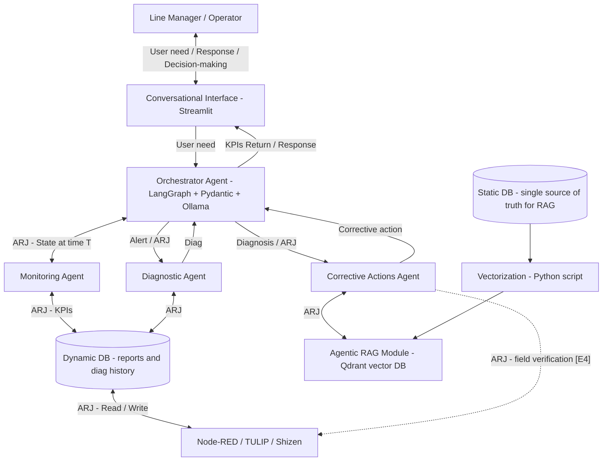
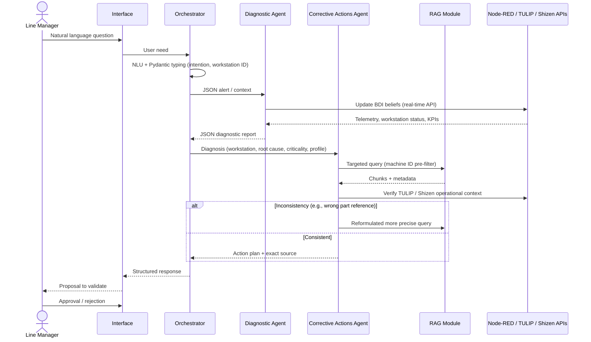
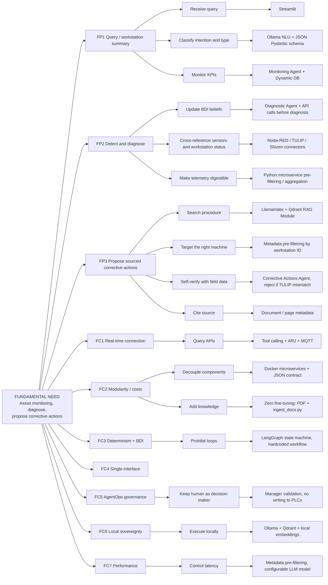
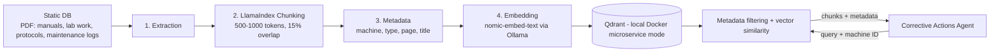

# PJE 17 — Agentic AI Assistance Platform for Controlling the Learning Factory 4.0
## Locking Minutes: Architecture & Functional Analysis

> **Convention:** `ARJ` = JSON REST API (diagram legend).

---

# 1. Context

## 1.1 Project Objectives

| # | Objective (source: scoping + PJE09 subject no. 17) |
|---|---|
| O1 | Assist line managers in daily production monitoring and decision-making |
| O2 | Automatically detect anomalies and establish a factual industrial diagnosis |
| O3 | Summarize the status of a workstation and propose concrete, sourced corrective actions compliant with Lean standards |
| O4 | Provide a modular platform (adding / modifying / removing agents without redesign) |
| O5 | *In the long term*: extend assistance to operators via new modalities (e.g., voice command) |

## 1.2 Business Challenges

- **Human bottleneck:** high data generation (Node-RED, TULIP, Shizen) but delayed decision-making due to scattered screens, manual cross-referencing, and manual searching through procedure binders.
- **Shift from reporting to action:** actionable response in a single conversational query (workstation summary + diagnosis + corrective action ready for validation).
- **Reliability:** *Critical* risk of procedural hallucination; *High* risk of erroneous decisions (siloed/incomplete data); *Medium* risks of inter-agent loops and user rejection (black box).
- **Industry 5.0 / Operator 4.0 framework:** AI augments humans, does not replace them (human-in-the-loop).
- **Technological showcase:** sustainable experimentation ground, reusable by future student cohorts.

## 1.3 Scope

| Included | Excluded |
|---|---|
| Single conversational interface (entry point) | LLM retraining / fine-tuning |
| Deterministic centralized orchestrator | Physical command or writing to PLCs |
| Agents: Monitoring, Diagnostic, Corrective Actions | Autonomous AI decision-making (mandatory human validation) |
| Real-time API connectors: Node-RED, TULIP, Shizen | Proprietary cloud LLM (data exfiltration) |
| Agentic RAG module + document ingestion pipeline | Decentralized / federated orchestration |
| AgentOps governance: source traceability, approval workflow | Operator voice command ("long term" horizon, O5) |
| 100% local execution (Ollama, Qdrant, Docker) | Replacement of TULIP / Node-RED / Shizen |

## 1.4 Actors, Target Users, Initial Constraints

**Actors**

| Actor | Role regarding the system | Key need | Risk to mitigate |
|---|---|---|---|
| Line manager (A.1) | Primary user, final decision-maker | Single interface, status report + auto-diagnosis, official procedure | Black box; requires source transparency |
| Line operator (A.2) | Workstation user (1st-level maintenance) | Short and instant step-by-step guide, autonomy | Bottleneck while waiting for the manager |
| Learning factory management / supervisors (A.3) | Methodological and technical guarantors | Modularity, determinism, scientific reliability | Non-scalable architecture, hallucinations |
| Future students / developers | Maintain and extend the platform | Add an agent / a PDF without redoing everything | Technical debt, tight coupling |
| Ingestion administrator | Executes `ingest_docs.py` | Updating the document base | — |
| External systems | Node-RED, TULIP, Shizen, internal documentation | Expose their data via API | — |
| IT Infrastructure Team | Provider of existing APIs | — | Facts: TULIP = Basic Auth (API key as username, secret as password), resource-scoped tokens (Tables, Operators, Machines, Apps) *(Tulip Support)*; Shizen = API offered by the vendor, non-public authentication → vendor documentation / onboarding *(vendor sheets)*; Node-RED = JSON/MQTT streams, broker credentials and ACLs to be obtained *(Dossier §2.2)*. Selected: one read-only service account per source, secrets in Docker environment variables. |

**Initial Constraints**

- **Sovereignty / confidentiality:** local processing, zero leakage to the cloud.
- **Zero-cost:** local + open-source infrastructures, no paid subscriptions/APIs.
- **Determinism:** no infinite inter-agent loops; hardcoded workflow.
- **Human-in-the-loop:** approval for any action impacting the line.
- **Traceability:** every corrective action cites the source documentary excerpt.
- **Hardware:** limiting local RAM/VRAM resources; configurable LLM model depending on the machine; local tool calling to be stabilized.
- **Latency:** "acceptable" despite multi-step reasoning of agentic RAG Targets: FP1 summary ≤ 10 s; FP2→FP3 sequence ≤ 30 s with progress displayed per step; 10 s = user attention limit, beyond which progress feedback is required *(NN/g)*; to be measured on local hardware *(Dossier §1.4)*.

## 1.5 Register of Discrepancies Between Sources (to be arbitrated)

| ID | Discrepancy | Working hypothesis adopted in this document |
|---|---|---|
| E1 | **RAG access:** diagram = direct link Corrective Actions Agent ↔ RAG; agent sheet = "queries the RAG Module **via the Orchestrator**"; initial brainstorming diagram = RAG connected to the Orchestrator | Query initiated by the Corrective Actions Agent, **mediated by the Orchestrator** (consistent with centralized control). Selected: CAA → Orchestrator → RAG (mediated query, single control point) *(Dossier §4.2, §4.6)*; §2.1 diagram to be aligned; validation by supervisor = remaining human action |
| E2 | **Vector database:** Qdrant (FAST, RAG guide, summary) vs ChromaDB (ingestion pipeline, summary "reads ChromaDB") | **Qdrant** selected (majority choice, Docker microservice). ChromaDB = prototype alternative |
| E3 | **"Read / Write"** diagram between Dynamic DB and Node-RED/TULIP/Shizen vs "AI does not write to PLCs" (FAST, CAA sheet) | Write = feeding the Dynamic DB only; **no commands sent to PLCs**. No writing to TULIP / Shizen in v1: read-only, token scopes limited to need *(Tulip Support; Dossier §1.3, FC5)*; ticket creation = post-v1 evolution subject to human approval |
| E4 | **Real-time access of the Corrective Actions Agent:** sheet = direct API connectors to TULIP/Shizen; diagram = no link CAA ↔ field sources | Access via the **connectors layer** (Python microservice), not shown on the diagram. The CAA reads TULIP / Shizen via the connectors layer (§4.7), read-only; keep the dashed link CAA → sources [E4] on the diagram *(Dossier §2.1, §4.5)* |
| E5 | **Role of the Dynamic DB:** diagram = "stores reports and diag history" + read/write link to sources; FAST = "field API (Dynamic DB)" | Dynamic DB = **application** persistence layer (reports, history, KPIs served to the Monitoring Agent); source replica/cache unconfirmed. Dynamic DB = application persistence (reports, history, KPIs as timestamped snapshots); no replica of sources: BDI beliefs are refreshed via API call before any diagnosis *(Dossier §4.4, FC3)* |
| E6 | **Operators:** target users in agent sheets and diagram ("Operator / Manager") vs "in the long term" in objectives | Line manager = v1 user; operator = target user, voice modality out of v1 scope |
| E7 | **Monitoring Agent:** present in diagram and FAST (linked to FP1), but no dedicated sheet or specific FP/FC | Linked to **FP1 (+ upstream FP2)**; detailed specification Linked to FP1 (+ upstream FP2); full sheet in §4.3 *(Dossier §4.3)* |
| E8 | **Origin of the "Alert"** (Orchestrator → Diagnostic Agent) unspecified | Both: (a) threshold breached detected by the Monitoring Agent, (b) user query classified as DIAGNOSTIC; in both cases the Orchestrator emits the JSON Alert, never Monitoring → Diagnostic directly *(Dossier §4.2, §4.3, FC3)* |
| E9 | **SQL/NoSQL technology** of Dynamic DB and Static DB unspecified | Dynamic DB: PostgreSQL (JSONB); Static DB: files + hash manifest *(details §5.2–5.3; PostgreSQL docs)* (§5) |

---

# 2. Functional Analysis

## 2.1 Overview and Purpose

**Fundamental need:** *Assist daily production monitoring, automatically diagnose anomalies, and propose corrective actions in order to accelerate decision-making* — serving the learning factory actors, acting on industrial data flows and databases, via a modular agentic AI platform.

**Architectural principle:** **hybrid (microservices)** architecture isolating connectivity (APIs, sessions) from business logic (AI reasoning) + **centralized orchestration** (a single deterministic "brain") + **BDI cognitive model** (beliefs updated via API prior to any intention) + **agentic RAG** (knowledge offloaded outside the LLM).

## 2.2 System ↔ External Environment Interactions

| External element | Direction | Nature of interaction | Related function |
|---|---|---|---|
| Line Manager / Operator | ↔ | Natural language queries; responses, KPIs, action plans; **approval / rejection** | FP1, FC4, FC5 |
| Node-RED | → | Sensor/machine streams (JSON/MQTT, time series, binary states) | FP2, FC1 |
| TULIP | → | Workstation status, routing step, cycle time vs takt time, operator reports (REST/JSON) | FP1, FP2, FP3, FC1 |
| Shizen / Lean | → | Real-time KPIs, open anomalies, tickets, continuous improvement standards | FP1, FP2, FP3, FC1 |
| Internal documentation (manuals, lab work, protocols, maintenance logs) | → | Offline ingestion (PDF) → vectorization | FP3, FC2 |
| IT Infrastructure / existing APIs | ↔ | Exposure of APIs consumed by the connectors | FC1 |
| Supervising team / developers | ↔ | Adding/removing agents, adding PDFs, choosing the LLM model | FC2 |
| PLCs / physical equipment | ✗ | **No writing / commanding** by AI | FC5 |

## 2.3 Main Flows

**Inputs**

| Flow | Origin | Format |
|---|---|---|
| User query | Interface | Free text |
| Structured intention + workstation ID | Orchestrator NLU | Pydantic typed JSON |
| Machine telemetry | Node-RED | JSON/MQTT, time series (pre-aggregated by Python microservice) |
| Frontline operations | TULIP | JSON (REST) + short text |
| KPIs / anomalies | Shizen | JSON + free text (tickets) |
| Technical documents | Static DB | PDF → chunks + metadata |

**Outputs**

| Flow | Recipient | Format |
|---|---|---|
| Workstation status / KPIs summary | Interface → user | Structured summary |
| Diagnostic report | Orchestrator, Dynamic DB | Structured JSON |
| Corrective action plan **with cited source** | Orchestrator → user | Ordered text + citation (document, page) |
| Decision (approval/rejection) | Interface → Orchestrator | Pydantic JSON {reco_id, poste_id, decision ∈ APPROUVE / REFUSE / MODIFIE, motif, user_id, horodatage}; logged in append-only table `decision_log` (Dynamic DB); graph resumed via `interrupt()` + `Command(resume=…)`, checkpointer required *(LangGraph docs; Dossier FC5)* |

**Nominal Flow (diagnosis → corrective action)**

---

# 3. Detailed Functional Analysis

## 3.1 Main Functions (FP)

| ID | Mission |
|---|---|
| **FP1** | Allow the line manager to query the platform in natural language (single entry point) to obtain a summary of a workstation's status |
| **FP2** | Automatically detect anomalies and establish a factual industrial diagnosis (root cause) by cross-referencing Node-RED, TULIP, and Shizen data |
| **FP3** | Propose concrete, sourced corrective actions by linking the diagnosis to internal procedures and documentation |

## 3.2 Constraint Functions (FC)

**FC1–FC5: official list from the scoping dossier. FC6–FC7: explicit requirements from the sources, originally unnumbered, added to complete sovereignty / performance coverage.**

| ID | Requirement | Category |
|---|---|---|
| **FC1** | Connect to and query existing applications and databases in real time via API (Node-RED, TULIP, Shizen) | Technical |
| **FC2** | Modular and scalable architecture (adding/removing agents; adding documents without retraining; controlled technological costs) | Technical |
| **FC3** | Deterministic system, anchored on the BDI model (beliefs updated prior to intention) | Reliability |
| **FC4** | Intuitive conversational interface serving as a single entry point | Ergonomics |
| **FC5** | Governance and traceability (AgentOps), human-in-the-loop, mandatory source citation, no writing to PLCs | Security / governance |
| **FC6** *(complementary)* | Sovereignty and confidentiality: local execution (LLM, embeddings, vector database), zero data sent to the cloud; zero-cost (open source) | Regulatory / security / budget |
| **FC7** *(complementary)* | Performance: acceptable response latency despite multi-step reasoning; compatibility with local hardware resources | Performance |

## 3.3 FAST Diagram

## 3.4 Specifications — Locked Summary

> **Priorities:** deduced from the risk levels of the governance matrix (Critical / High / Medium), not explicitly set in the sources. Priorities kept as derived from the risk matrix (Critical: FP3, FC3, FC5; High: FP1, FP2, FC1, FC2, FC6; Medium: FC4, FC7) *(Dossier §1.2 and table below)*; validation by supervisor = remaining human action
> **KPIs:** the sources set qualitative targets ("all", "systematically"), interpreted as 100%. Numerical latency thresholds are absent.

| ID | Description | Acceptance criteria / KPI | Priority |
|---|---|---|---|
| **FP1** | Natural language query → workstation summary | The Orchestrator queries the API connectors and returns a structured summary of the workstation's real-time KPIs in a **single query**; intention + workstation ID extracted in valid Pydantic JSON | High |
| **FP2** | Anomaly detection and root cause diagnosis | Diagnostic Agent identifies the root cause by cross-referencing sensor alert (Node-RED) and workstation status (TULIP) on **test scenarios**; systematically valid JSON report | High |
| **FP3** | Sourced corrective actions | **100%** of proposed actions cite an actual excerpt from documentation (document + page) from RAG; plan compliant with Lean standards; excerpt rejected if inconsistent with TULIP | **Critical** |
| **FC1** | Real-time connection to APIs | Operational connectors for Node-RED (MQTT), TULIP, Shizen; ARJ exchanges; raw data pre-filtered before LLM | High |
| **FC2** | Modularity / scalability / costs | Adding an agent without rewriting existing code (JSON contract + orchestrator); adding a PDF = file drop + ingestion rerun, **without retraining** | High |
| **FC3** | Determinism + BDI | **100%** of test scenario queries result in a structured response; **BDI grounding rate = 100%** (systematic API call before diagnosis, no hallucinated sensor state); 0 infinite loops | **Critical** |
| **FC4** | Single interface | A single entry point providing access to Monitoring, Diagnosis, Corrective Actions | Medium |
| **FC5** | Governance / AgentOps / human-in-the-loop | Documentary source displayed for each recommendation; approval workflow before any action impacting the line; no PLC writes. Content: thread_id, timestamp, intention + workstation ID, diagnostic report, cited RAG chunks (document, page), proposed plan, human decision, LLM model used, latency per step; storage: append-only tables `agentops_log` / `decision_log` in PostgreSQL + LangGraph checkpoints *(LangGraph docs; Dossier FC5)* | **Critical** |
| **FC6** | Local sovereignty, zero-cost | No calls to any paid or external cloud service; LLM, embeddings, vector DB hosted locally | High |
| **FC7** | Performance | "Acceptable" response time despite multi-step processing. FP1 ≤ 10 s; FP2→FP3 ≤ 30 s with step-by-step progress *(NN/g; cf. §1.4)*; to be validated by measurement on target hardware | Medium |

---

# 4. Detailed Architectural Choices by Agent

## 4.0 Overview and Cross-Cutting Stack

**Allocation principle:**

| Component | Nature | Responsibility | FP/FC |
|---|---|---|---|
| Conversational interface | Front-end | Single entry point, human approval | FP1, FC4, FC5 |
| Orchestrator Agent | Agent (router) | NLU, typing, workflow, consolidation | FP1–FP3, FC2, FC3, FC5 |
| Monitoring Agent | Agent | KPI surveillance | FP1, FP2 (upstream), FC1 |
| Diagnostic Agent | Agent | BDI beliefs + root cause | FP2, FC1, FC3 |
| Corrective Actions Agent | Agent | Sourced procedure + self-verification | FP3, FC3, FC5 |
| RAG Module | Component | Filtered vector search | FP3, FC2, FC5, FC6 |
| Connectors layer | Python microservice | API access, pre-filtering/aggregation | FC1, FC7 |

**LLM / Inference Stack (cross-cutting across all agents)**

| Building block | Evaluated options | Choice | Justification |
|---|---|---|---|
| Inference engine | vLLM, llama.cpp, Ollama | **Ollama** | Simple deployment, OpenAI-compatible REST API, automatic model management, optimized CPU/GPU hardware load → FC6, FC7. Rejections: vLLM (dedicated CUDA GPU, unjustified overhead for a prototype); llama.cpp (substantial code plumbing, single-stream). Accepted limitation: single-user / prototyping |
| Model type | Proprietary cloud (GPT-4o-mini, Claude 3.5 Sonnet), local open weights, code-specialized models (Qwen-Coder, CodeLlama) | **Local open weights** (Llama 3.2 3B / Llama 3 8B cited) | Cloud rejected: cost + data exfiltration (violates FC6). Code models: good at JSON/API syntax but weaker at educational synthesis. Limitation: local tool calling to be stabilized |
| Model selection | — | **Runtime-configurable model** | Adaptation to hardware; lightweight model (prototyping) vs robust model (validation) → FC2, FC7. One model per agent, declared in configuration (§5.3); final list = Llama 3.2 3B (prototyping) and Llama 3 8B (validation) *(Dossier §4.0)*; outputs constrained by JSON schema to narrow the gap between models *(Ollama docs)* |

---

## 4.1 Conversational Interface (front-end component)

- **Name and role:** Conversational interface (Streamlit) — sole point of human contact; displays summaries, KPIs, action plans, and sources; handles approval/rejection.
- **Covered need:** **FP1**, **FC4**, **FC5** (human validation, source display).
- **Architectural justification:** Streamlit (100% Python) connects natively to backend logic without a dedicated front/back API. Rejected: React/Vue.js (deemed heavy). Chainlit cited as a Python alternative. Limitation: Streamlit is not designed for high concurrency (consistent with prototype scope).
- **Inputs / Outputs & Tools:**
  - *Inputs:* free text; approval/rejection action.
  - *Outputs:* prompt to Orchestrator; structured response + sources; KPIs ("KPIs Return").
  - *Tools:* `app.py` script. Approval: Approve / Reject / Modify buttons under each plan → decision object (§2.3); logging: `decision_log` table; authentication: native Streamlit OIDC (`st.login` / `st.user`, version ≥ 1.42, OIDC provider required) *(Streamlit docs)*; without an on-site OIDC provider: local profile selection, without strong authentication value (prototype)

## 4.2 Orchestrator Agent

- **Name and role:** Centralized Orchestrator Agent — **software router, non-solver**. Cycle: (1) listen, (2) classify intention (NLU via LLM), (3) type/format into JSON, (4) execute hardcoded workflow to sub-agents, (5) consolidate response. Only agent linked to the interface.
- **Covered functional need:** **FP1** (understanding and entry point), delegation of **FP2** and **FP3**; **FC2** (JSON contract), **FC3** (determinism), **FC4**, **FC5**, **FC6**, **FC7**.
- **Architectural justification:**

| Decision | Justification | Rejected alternatives |
|---|---|---|
| **Centralized orchestration** | Single point of control → consistency, predictability, zero inter-agent communication loops (FC3); hides complexity from the user (FP1) | Decentralized (decision anarchy, slow decisions, coordination overhead); federated (relevant for independent entities, out of scope); hierarchical (unjustified management complexity) |
| **LangGraph (state machine)** | Fixed paths: *Diagnosis* → always *Corrective Actions*; enforced flow direction → loop impossible (FC3/FC5) | "Free" agent frameworks (risk of loops) |
| **Pydantic + Ollama (NLU)** | Strict schema (intention Enum), restricted system prompt, mandatory valid JSON output; **JSON is the interface contract**: any new agent knows what to read (FC2) | Free text output (routing hallucination) |
| **Hybrid microservices architecture** | Isolates connectivity / reasoning, reduces cyclomatic complexity, allows adding agents without redesign (FC2) | Monolith |

  *Accepted limitation:* bottleneck at the leader level (inherent to the vertical approach), acceptable for a limited number of agents.
- **Inputs / Outputs & Tools:**
  - *Inputs:* text prompt; JSON reports from agents; human decision.
  - *Outputs:* typed JSON object (intention, workstation ID); ARJ calls to agents; consolidated response to interface; "Alert" to Diagnostic Agent; "Diagnosis" to Corrective Actions Agent.
  - *Tools:* LangGraph, Pydantic, Ollama.
  - *Open points:* Enum = SUIVI, DIAGNOSTIC, HORS_PERIMETRE (corrective action is not a direct intention: always chained after DIAGNOSTIC) *(Dossier §3.3)*; out of scope: standard redirection response, no agent called, output typed by JSON schema *(Ollama docs)*; persistence: LangGraph checkpointer (PostgreSQL; SQLite in single-machine prototype), one `thread_id` per session *(LangGraph docs)*; Alert trigger: cf. E8

## 4.3 Monitoring Agent

- **Name and role:** Monitoring Agent — **upstream** KPI surveillance block (Shizen/TULIP) prior to alert; provides "State at time T" and "KPIs Return" to the Orchestrator, relying on KPIs from the Dynamic DB (diagram).
- **Covered functional need:** **FP1** ("workstation status report" use case, real-time KPI summary), **FP2** (upstream of detection), **FC1**, **FC2** (example of a modularly added agent). `[E7]`
- **Architectural justification:** distinct agent from Diagnostic to maintain a strict scope (limits cyclomatic complexity) and illustrate modular extensibility ("easily add new agents, e.g., Monitoring Agent"). Read-only, without writing diagnoses or consulting documentation *(scope deduced from FAST/diagram split, not explicit in a sheet)*. Rejected alternative: having the Orchestrator handle surveillance (would violate its role as a simple router).
- **Inputs / Outputs & Tools:**
  - *Inputs:* ARJ query from Orchestrator; KPIs via Dynamic DB / Shizen-TULIP API.
  - *Outputs:* state at time T and KPIs in ARJ format.
  - *Tools:* API connectors.
  - Mode: periodic polling by the connectors layer (Node-RED via aggregated MQTT subscription) + on-demand reading; 60 s default frequency, configurable; KPIs: Shizen (real-time KPIs, open anomalies) and TULIP (workstation status, cycle time vs takt time) *(Dossier §2.2)*; alert thresholds per workstation in configuration, never decided by the LLM (FC3); JSON output {poste_id, horodatage, kpis, ecarts, alerte}

## 4.4 Diagnostic Agent

- **Name and role:** Diagnostic Agent — updates its **BDI beliefs** via real-time API calls, then cross-references sensor streams and workstation status to establish the root cause. Never called directly by a human (triggered by the Orchestrator).
- **Covered functional need:** **FP2** (primary), **FC1** (real-time access), **FC3** (BDI grounding), **FC7** (digestible JSON summaries).
- **Architectural justification:**
  - **BDI:** the factory is a continuous dynamic environment; the agent does not react blindly to an alert, it first verifies that its belief justifies the intention → mitigates the *High* risk of erroneous decisions.
  - **Strict scope:** does not search manuals, does not draft the action plan (FP3's role). Prevents overlaps and loops.
  - **Pre-processing via Python microservice:** raw telemetry (time series) is pre-filtered/aggregated into a JSON summary before reaching the LLM (an LLM cannot digest raw series; FC7).
  - *Rejected:* diagnosis by an LLM alone without API calls (hallucination of sensor state).
- **Inputs / Outputs & Tools:**

| Input | Source | Content |
|---|---|---|
| Intention + context | Orchestrator | JSON (intention, workstation ID) |
| Machine streams | Node-RED | JSON/MQTT, time series: physical values, binary states (part presence 0/1, red light, emergency stop) |
| Frontline operations | TULIP | Workstation status, routing step, cycle time vs takt time, operator reports |
| Performance / anomalies | Shizen | Real-time KPIs, open anomalies, drifts |

  - *Outputs:* structured JSON diagnostic report → Orchestrator; writing report/history to Dynamic DB (diagram, double ARJ arrow).
  - *Tools:* tool calling on API connectors (Node-RED, TULIP, Shizen).
  - *KPIs:* BDI grounding rate, root cause accuracy (Node-RED alert × TULIP status correlation), output format validity.
  - Report = {poste_id, horodatage, cause_racine, niveau_criticite, profil_utilisateur, preuves[{source, valeur, horodatage}]} validated by Pydantic *(minimal fields: Dossier §4.5; schema constraint: Ollama docs)*; `preuves` added to trace BDI grounding; access: direct API via connectors before each diagnosis, Dynamic DB reserved for persistence *(Dossier FC3, E5)*

## 4.5 Corrective Actions Agent

- **Name and role:** Corrective Actions Agent — acts **downstream** of diagnosis; transforms the root cause into a sourced corrective action plan compliant with Lean standards; carries the **agentic** dimension of RAG (decomposition, cross-referencing sources, self-verification, reformulation).
- **Covered functional need:** **FP3** (primary), **FC3** (field grounding, flow determinism), **FC5** (mandatory citation, recommendation assistant subject to approval), **FC2** (externalized knowledge).
- **Architectural justification:**
  - **RAG** rather than fine-tuning: eliminates the *Critical* risk of procedural hallucination (injection of exact context), avoids costly retraining with every new manual, allows adding PDFs without touching the model (FC2); a traditional API does not understand the meaning of a PDF and a full manual would saturate the context window.
  - **Agentic RAG** rather than traditional RAG: a reactive RAG would blindly trust the retrieved document, without self-verification. Here, if TULIP indicates a different part reference / step, the excerpt is **rejected** and a more precise query is relaunched. Accepted cost: higher latency (multi-step) → compensated by metadata pre-filtering.
  - **Bounded self-verification loop:** Maximum 2 reformulations (3 RAG queries total); fallback: return diagnosis alone + "no validated procedure found", escalation to manager, no fabricated plan *(Dossier FP3: 100% sourced)*; counter in graph state + LangGraph `recursion_limit` as a safeguard (25 by default) *(LangGraph docs)*.
- **Inputs / Outputs & Tools:**

| Input | Source | Content |
|---|---|---|
| Validated diagnostic report | Orchestrator | JSON: workstation ID, root cause, criticality, user profile (adapts language level) |
| Documentary excerpts | RAG Module | Chunks + metadata (document title, machine, type, page) |
| Operational / Lean context | TULIP, Shizen (API) | Routing step, ongoing operator instructions, ticket history, continuous improvement standards |

  - *Outputs:* sequenced, concrete action plan, with **exact citation** (document, page) → Orchestrator → interface → human validation.
  - *Tools:* RAG query with machine ID pre-filter; TULIP/Shizen API connectors (via connectors layer, [E4]); LLM (Ollama).
  - *Out of scope:* raw telemetry analysis (role of Diagnostic Agent), any writing/commanding on PLCs.

## 4.6 RAG Module (non-decision-making component)

- **Name and role:** RAG Module — retrieval service: vector similarity search + metadata filtering on the vector database; returns chunks and metadata. Fed offline by an ingestion script.
- **Covered need:** **FP3**, **FC2**, **FC5** (traceability), **FC6**, **FC7**. Details §5.1.
- **Justification:** isolated component (Docker microservice) to respect the connectivity/reasoning separation; verification intelligence is carried by the Corrective Actions Agent, the module remains deterministic in retrieval. Access: cf. [E1].
- **I/O & tools:** input = query + machine ID; output = top chunks + metadata; tools: LlamaIndex, Qdrant, Ollama embeddings.

## 4.7 Connectors Layer (Python microservice)

- **Name and role:** API connectors to Node-RED (MQTT), TULIP, Shizen; pre-filtering and aggregation of time series.
- **Covered need:** **FC1**, **FC7**, **FC2** (connectivity isolation).
- **Justification:** isolates connectivity logic from AI logic (hybrid architecture); passes JSON summaries rather than raw streams to the LLM.
- **I/O & tools:** inputs = REST/MQTT APIs; output = normalized JSON; used via tool calling. Node-RED: MQTT broker, one topic per machine *(Dossier §2.2)*; TULIP: REST `https://{instance}.tulip.co/api/v3/w/{workspace}/…`, Basic Auth key / secret *(Tulip Support)*; Shizen: vendor API, endpoints and auth in vendor docs *(vendor sheets)*; frequencies: cf. §4.3 (60 s by default); mapping: configuration table `poste_id ↔ machine_id ↔ topic MQTT ↔ station TULIP`, `machine_id` = `machine` metadata of RAG *(Dossier §5.1)*

---

# 5. Architectural Choices and Solutions for Databases

## 5.1 RAG Architecture (vector database)

**Ingestion pipeline (offline, run by an administrator via `ingest_docs.py`)**

| Parameter | Decision | Justification (need) | Status |
|---|---|---|---|
| **Chunking** | 500–1000 token segments, 15% overlap (LlamaIndex) | Never cut a procedure in the middle; avoid context saturation → FP3, FC7 | Locked ("example" values in source) |
| **Mandatory metadata** | `{machine, type, page}` + document title, per chunk | Strict pre-filtering by machine; citation of exact page → FC5 (AgentOps), FP3 | Locked |
| **Embeddings** | `nomic-embed-text` via Ollama (cited "e.g.") | Local model, semantic vectors → FC6 | Confirmed: `nomic-embed-text`, dimension 768, 8192 token context *(Ollama library; Ollama wrappers)* → `size=768` at Qdrant collection creation |
| **RAG Framework** | **LlamaIndex** (or custom Python hybridization) | Excellent handling of complex PDFs and chunk ↔ source document link → FC5 | Locked |
| **Vector database** | Local containerized **Qdrant** (Docker) | Confidentiality (FC6), microservice isolation (FC2) | Locked [E2] |
| **Retrieval strategy** | Vector similarity + **machine ID pre-filtering** (ID provided by Orchestrator) | Prevents returning a similar procedure from another machine; narrows search space → latency (FC7) and context errors (FC3) | Locked |
| **Hybrid lexical + semantic search (BM25 or equivalent)** | Not mentioned in sources | — | Not selected in v1: similarity + `machine` pre-filter are sufficient *(Dossier §5.1)*; option if exact references (part codes) are poorly retrieved: Qdrant natively handles sparse + dense vectors with filters *(Qdrant docs)* |
| **Query parameters** | — | — | Cosine metric (standard for text embeddings) *(Qdrant docs)*; top-k = 5 (starting value); score threshold to be calibrated on test scenarios set (Qdrant allows filtering by score) *(Qdrant docs)*; chunk rejected if score < threshold or inconsistent with TULIP context (part reference / step) → bounded reformulation (§4.5) |
| **Updating** | Dropping the PDF into the folder + rerunning the script; agent only reads the database | Zero retraining → FC2 | Locked. Incremental: LlamaIndex `IngestionPipeline` + docstore (per-document hash: modified → re-indexed, unchanged → ignored), `upserts_and_delete` strategy to remove deleted PDFs *(LlamaIndex docs)* |

**Separation of duties:** the ingestion script (administrator) is decoupled from the Corrective Actions Agent, which has **read-only** access to the vector database.

## 5.2 Dynamic Databases

**Scope (diagram): "Dynamic DB — stores diagnostic reports and history"**, read by the Monitoring Agent (KPIs) and the Diagnostic Agent (read/write), linked in read/write to Node-RED / TULIP / Shizen.

| Data | Producer → Consumer | Need | Status |
|---|---|---|---|
| Diagnostic reports (JSON) | Diagnostic Agent → DB → Orchestrator / CAA | FP2, FP3 | Cited (diagram) |
| Diagnostic history | Diagnostic Agent → DB | FP2, FC5 (traceability) | Cited (diagram) |
| Real-time KPIs / state at time T | Sources → DB → Monitoring Agent | FP1, FC1 | Cited (diagram) |
| Pre-aggregated telemetry | Node-RED → connectors layer | FP2, FC7 | Transient (JSON summary aggregated in memory by connectors); only the summary cited in a report is persisted with it *(Dossier §4.4, FC7)* |
| Workflow state / conversational memory | Orchestrator (LangGraph) | FC3, FP1 | LangGraph checkpoints in PostgreSQL (SQLite in prototype), one `thread_id` per session *(LangGraph docs)* |
| AgentOps logs / approval decisions | Interface, Orchestrator | FC5 | Append-only tables `agentops_log` and `decision_log`; content defined in §3.4 (FC5) |

- **Technology (SQL / NoSQL):** **PostgreSQL**: reports in `JSONB` + GIN index (containment queries on history), local Docker container, open source; prototype alternative: SQLite *(PostgreSQL docs; LangGraph docs for checkpointers)*. Selection criteria deducible from sources: JSON document storage (reports), queryable history, ARJ access, local and containerizable execution (FC2, FC6), zero-cost (open source).
- **Governance rule:** writes apply to the Dynamic DB, never to PLCs (FC5) `[E3]`.

## 5.3 Static Databases / Repositories

| Repository | Content | Role | Status |
|---|---|---|---|
| **Static DB** (diagram: "single source of truth for RAG") | PDFs: technical manuals, lab sessions, internal protocols, maintenance logs | Single source for vectorization; no agent reads PDFs directly | Locked. Storage = file folder ("drag the PDF into the folder") Single folder `data/static/` mounted as Docker volume; naming convention `<machine>_<type>_<title>_vN.pdf` (feeds `machine`, `type`, title metadata); versioning: `vN` suffix + content hash tracked by LlamaIndex docstore *(LlamaIndex docs; Dossier §5.1)* |
| Fixed metadata | `machine`, `type`, `page`, title | Filtering and citation | Locked (carried by chunks in Qdrant) |
| Learning factory Lean standards | Action plan compliance rules | FP3 compliance | Documents ingested into RAG with `type=standard_lean` (same document / page citation); continuous improvement standards exposed by Shizen remain read via API *(Dossier §2.2, §5.1)* |
| Platform configuration | LLM model choice, workstation ↔ machine ID mapping, API endpoints | FC2, FC7 | Versioned `config.yaml` file (LLM model per agent, workstation ↔ machine ID mapping, endpoints, thresholds per workstation, RAG parameters); secrets in environment variables *(Dossier FC2, FC6)* |
| Maintenance history vs diagnostic history | Maintenance = static documentary; diagnostics = dynamic | Avoid scope confusion | No, not by default: strict static / dynamic separation, RAG remains anchored solely on the Static DB *(Dossier §5.3, diagram)*; re-ingestion possible as `type=historique_diagnostic` after human validation (evolution) |

## 5.4 Comparative Table of Envisioned Solutions

| Building block | Solution | Advantages | Limitations | Decision |
|---|---|---|---|---|
| **Vector database** | Pinecone (cloud) | Fast, managed | Industrial confidentiality (violates FC6), cost | ❌ Rejected |
| | ChromaDB | Local, simple, disk persistence | Cited in ingestion pipeline; less aligned with microservice isolation | ⚠️ Prototype alternative [E2] |
| | **Qdrant** | Local, Docker-containerizable, metadata filtering | Dedicated service setup required | **Selected** |
| **RAG Framework** | LangChain | Industry standard, very comprehensive | Sometimes heavy | ❌ Rejected |
| | **LlamaIndex** | Specialized in RAG, complex PDFs, metadata, chunk ↔ source link | Narrower ecosystem | **Selected** (or custom Python hybridization) |
| **Retrieval** | Pure similarity | Simple | Similar procedure from another machine | ❌ Rejected |
| | **Similarity + metadata pre-filter (machine ID)** | Accuracy, reduced latency, anti-context error | Requires rigorous metadata at ingestion | **Selected** |
| **LLM Adaptation** | Fine-tuning | Knowledge embedded in model | High cost, retraining with every manual | ❌ Rejected |
| | **RAG** | External knowledge, instant updates, citations | Additional latency | **Selected** |
| **RAG Type** | Traditional RAG | Fast, low latency | Reactive, no self-verification | ❌ Rejected |
| | **Agentic RAG** | Self-verification, source cross-referencing | Higher latency | **Selected** |
| **Embeddings** | **nomic-embed-text (Ollama)** | Local, integrated into inference engine | Model cited as an example | Selected, confirmed: dim. 768, context 8192 *(Ollama library)* |
| **Dynamic database** | SQL (PostgreSQL JSONB) vs dedicated NoSQL | Indexable JSONB (GIN), concurrent multi-container writes, local open source | Additional service to deploy | **PostgreSQL (JSONB)** selected; SQLite = single-process prototype alternative; dedicated NoSQL rejected (extra service with no need) *(PostgreSQL docs; Dossier §5.2)* |
| **Static database** | File system (PDF folder) | Trivial addition by student cohorts | No native versioning | Implicitly selected, confirmed: volume-mounted folder + hash manifest as versioning (no DMS in v1, zero-cost FC6) *(LlamaIndex docs; Dossier §5.3)* |

---

### Cited External Sources
- **Tulip Support**: https://support.tulip.co/docs/set-up-a-tulip-api.md · https://support.tulip.co/docs/operator-api-guide
- **Shizen vendor sheets** ("API" feature listed): https://www.softwareadvice.com.au/software/512187/Shizen · https://euro-stack.com/solutions/shizen
- **NN/g** (0.1 / 1 / 10 s response time limits): https://www.nngroup.com/videos/3-response-time-limits-interaction-design/
- **LangGraph docs** (interrupts, persistence, recursion limit), via summaries: https://wetheflywheel.com/en/radar/langgraph-review/ · https://fixdevs.pages.dev/blog/langgraph-not-working/
- **Ollama library** (`nomic-embed-text`, 8192 context): https://registry.ollama.ai/library/nomic-embed-text ; 768 dimension: https://pkg.go.dev/github.com/richardwooding/ollamaembed
- **Ollama docs** (structured outputs, doc copy): https://lzw.me/docs/ollama/en/capabilities/structured-outputs.html
- **Qdrant docs** (metrics, sparse vectors, score filtering): https://search.qdrant.tech/md/documentation/search/search/
- **LlamaIndex docs** (ingestion + docstore, per-document hash): https://developers.llamaindex.ai/python/examples/ingestion/document_management_pipeline/index.md · https://developers.llamaindex.ai/python/framework-api-reference/ingestion
- **PostgreSQL docs** (JSONB, GIN index), via: https://neon.com/docs/data-types/json.md
- **Streamlit docs** (OIDC, `st.login` / `st.user`): https://docs.streamlit.io/develop/concepts/connections/authentication